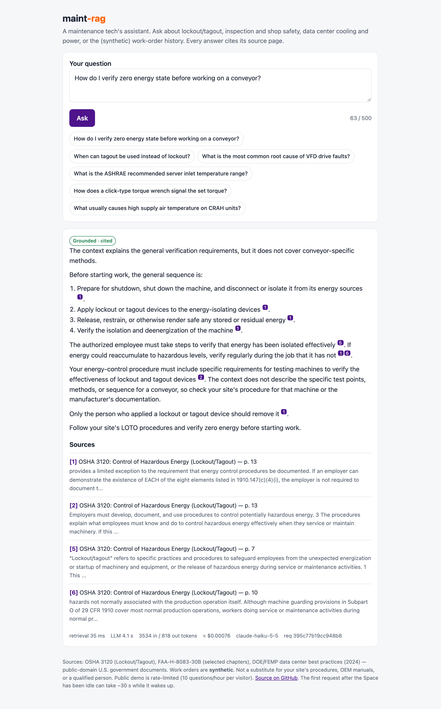
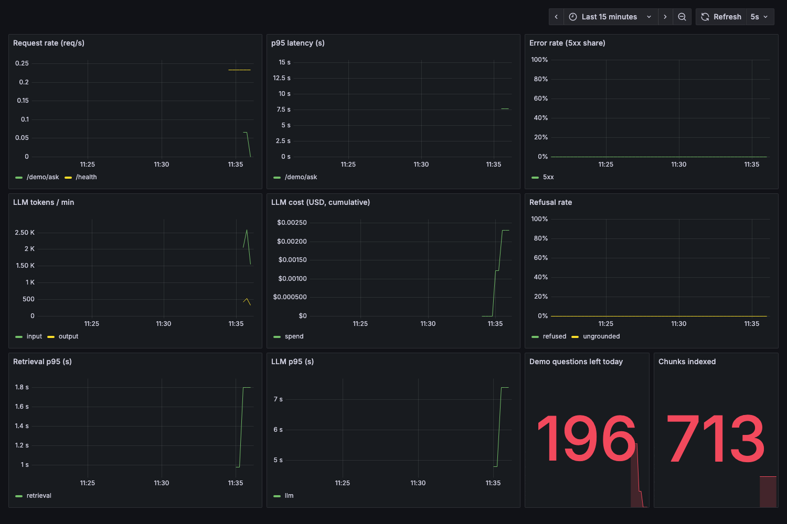
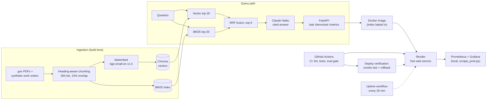

# maint-rag

[](https://github.com/TTOD-SOL/maint-rag/actions/workflows/ci.yml)


**A maintenance and data center operations assistant that answers from the manual, cites the page, and says
"I don't know" when the manual doesn't cover it.** I've turned wrenches on conveyors, motors, and drives
since 2020, and before that on aircraft in the U.S. Air Force. This is the assistant I wished I had on
the floor: fast, grounded in real documents, and honest about what it doesn't know.

### **[Live demo: maint-rag.onrender.com](https://maint-rag.onrender.com)**

> It runs on Render's free tier, which sleeps when idle. If it's cold, the first load takes about a minute.
> That's expected (see the [runbook](docs/RUNBOOK.md#4-sleeping-and-cold-starts-expected-not-a-fault)).
> The public demo is limited to 10 questions per hour per visitor.

<p align="center">
  
  
</p>

## What it does

- Answers questions about **lockout/tagout** (OSHA 3120), **aviation maintenance practice** (FAA-H-8083-30B,
  selected chapters), **data center cooling and power** (DOE/FEMP guide), and a **synthetic work-order
  history** (e.g. "most common root cause of VFD faults").
- Every claim carries an inline citation `[n]` that maps to a real retrieved passage (source, page, snippet).
- Refuses when the context can't support an answer, and reminds the reader to follow site LOTO procedures
  on safety-related questions.

## Architecture



## Evaluation

Measured on a 33-question golden set written from the corpus (30 answerable across LOTO, aviation, data
center, and work orders, plus 3 unanswerable). Retrieval metrics are deterministic and run in CI as a gate
(hybrid hit@6 must stay at or above 0.80). Full output: [`eval/results.md`](eval/results.md).

| Retrieval | hit@6 | MRR@6 | hit@3 |
|---|---|---|---|
| **hybrid (vector + BM25, RRF)** | 0.933 | **0.907** | **0.900** |
| vector only | 0.933 | 0.816 | 0.833 |
| BM25 only | 0.967 | 0.868 | 0.933 |

| Answers (`claude-haiku-5-5`) | |
|---|---|
| Keyword coverage | 0.933 |
| Citation validity (every `[n]` maps to a retrieved chunk) | 100% |
| Correct refusals on unanswerable questions | 3 of 3 |
| False refusals on answerable questions | 1 of 30 |
| Latency p50 / p95 (end to end, full CPU) | 1.7 s / 3.4 s |
| Cost per query | about $0.0005 |

**The hybrid-vs-vector finding.** Hybrid ties vector on hit@6 (0.933), but it ranks the right chunk higher:
MRR 0.907 vs 0.816, and hit@3 0.900 vs 0.833. That matters because the model reads chunk [1] first. BM25
alone actually has the best hit@6 here, since this corpus is full of exact terms (fault codes, CFR
sections, "energy isolating device"), but it misses paraphrased floor-language questions. Hybrid keeps
the lexical wins and handles the paraphrases, so it's the default. Chunking mattered more than the
retriever: heading-aware chunks lifted hybrid MRR from 0.79 (fixed windows) to 0.89, and 350-token chunks
to 0.91. See [`eval/experiments.md`](eval/experiments.md) and [DECISIONS.md](docs/DECISIONS.md).

**Honest limits.** 33 questions is a small set, so treat these numbers as a regression gate, not a
benchmark. I tightened the matcher so a hit needs the right page *and* a must-include keyword. My first,
looser matcher scored hybrid at 1.000, which overstated quality. Keyword coverage is a proxy for answer
quality; I don't have an LLM judge or human grading.

## Run it locally

```bash
uv sync                                   # Python 3.11, no torch
uv run python -m rag.ingest               # build the Chroma + BM25 index (PDF text is cached in the repo)
ANTHROPIC_API_KEY=sk-... uv run python -m rag.ask "How do I verify zero energy state before working on a conveyor?"
```

More:

```bash
ANTHROPIC_API_KEY=... APP_API_KEY=anything uv run python -m app.main   # API + demo UI on :7860
docker compose up --build                  # app + Prometheus + Grafana (http://localhost:3000)
uv run pytest && uv run ruff check .       # 27 tests, no API key needed (LLM is mocked)
uv run python -m eval.run_eval --retrieval-only   # free, deterministic
```

## Tech stack

Python 3.11 · FastAPI · Pydantic · Anthropic SDK (Claude Haiku) · fastembed (ONNX, CPU) · Chroma ·
rank_bm25 · slowapi · Prometheus + Grafana · Docker (multi-stage, non-root) · GitHub Actions · Render ·
uv · ruff · pytest

## Design decisions and cost controls

Details and the numbers behind them are in [docs/DECISIONS.md](docs/DECISIONS.md). The short version:

- **Hybrid retrieval with RRF**, because the corpus mixes exact identifiers with natural-language questions.
- **No torch.** ONNX embeddings on CPU keep the image at about 1.0 GB and the process at about 262 MiB
  peak, inside Render's 512 MB limit (measured under a hard cap with `scripts/mem_check.sh`).
- **Index baked into the image** at build time: fast starts, no volume, no network for retrieval.
- **Grounding is enforced and measured**: citations must map to retrieved chunks, and refusals are tested.
- **Spend is capped three ways**: 10 questions/hour per IP, a global daily cap (default 200/day, about $0.15 at
  worst), and a cheap, fast model. At 100 questions a day the Anthropic bill is about **$1.60 to $2.40 a
  month**; hosting is $0.
- **Logs never contain keys or prompts**; every request has an ID returned in `X-Request-ID`.
- **CI gates quality, not just syntax**: retrieval hit@6 below 0.80 fails the build. Deploys are
  verified with a smoke test and can roll back.
- **Hosting pivot, documented:** I planned Hugging Face Spaces, but Docker Spaces now require a paid PRO
  plan, so it runs on Render's free tier. The HF script is kept as an
  [alternative](docs/DEPLOY.md).

## Operations

[`docs/RUNBOOK.md`](docs/RUNBOOK.md) is written like a maintenance runbook: symptom, checks, fix, confirm.
It covers API key errors, rate limits, cold starts, LLM quota, failed builds, and rollback. An uptime
workflow opens a GitHub issue when production fails its health check and closes it on recovery.

## What I'd do next

- **Managed vector store** (pgvector or a hosted DB) instead of an index baked into the image, so the
  corpus can update without a redeploy.
- **Cross-encoder reranker** on the fused top-20 to improve MRR further, measured against the same gate.
- **Port to AWS ECS + Bedrock or Google Cloud Run**; the LLM sits behind a small interface (`rag/llm.py`).
- **LangGraph agent for multi-step troubleshooting**: ask a clarifying question, pull the asset's work
  history, then walk the fault tree.
- **Real CMMS data** (with the proper approvals) in place of synthetic work orders, plus a larger golden
  set and an LLM or human grader for answer quality.

## Data and disclaimers

- The document corpus is **public-domain U.S. government material**: OSHA 3120, the DOE/FEMP data center
  best-practices guide, and selected chapters of FAA-H-8083-30B. Download script: `scripts/download_corpus.py`.
- The **work orders are synthetic**, generated by `scripts/generate_work_orders.py` (seeded, with correlated
  failure modes). They are labeled as synthetic in the data file, in the UI, and here. No real company
  data is used.
- This is a personal portfolio project. It is **not affiliated with or endorsed by any employer**, and it is
  **not a substitute** for your site's procedures, OEM manuals, or a qualified person. Always follow your
  site's lockout/tagout procedures.
